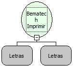

Descrição:

Essa função recebe como parâmetro uma constante letras, que será o texto a ser impresso e o identificador da impressora que é opcional.

Parâmetros:

1. Texto para ser impresso

2. Identificador da Impressora Opcional

Retorno:

Inteiro

Observações:

1. Para obter o identificador da impressora você deve utilizar a função "Iniciar Impressora" que retorna o Identificador. Esse identificador só será usado em caso de mais de uma impressora.

2.  Para imprimir com impressoras não-fiscal, deve-se usar a função "Bematech - Texto Formatado

Exemplo:

Bematech Imprimir Texto

Parâmetro 1 : "TESTE IMPRESSÃO" (Texto para ser impresso)

Parâmetro 2 : NULL  (Identificador da Impressora Opcional)

Retorno :       Código do Retorno do comando

Nome Real:

ebfBematechBematechTX

Compatibilidade:

Cliente
