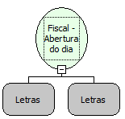

Descrição:

Faz a abertura do caixa emitindo um suprimento e uma leitura X. Essa função grava o COO inicial e o Grande Total  inicial que serão usados na função Bematech_FI_RelatorioTipo60Mestre. Portanto, se você for emitir o relatório "tipo 60 mestre" é obrigatório o uso dessa função.

Parâmetros:

Valor do suprimento (14 dígitos com 2 casas decimais) - Informe o valor "0" para não fazer suprimento. Forma de pagamento (16 caracteres) - Se não for informado, o suprimento será feito em Dinheiro.

Retorno:

0: Erro de comunicação.

1: OK.

2: Parâmetro inválido na função.

4: O arquivo de inicialização BemaFI32.ini não foi encontrado no diretório de sistema do Windows.

5: Erro ao abrir a porta de comunicação.

27: Status da impressora diferente de 6,0,0 (ACK, ST1 e ST2).

Nome Real:

ebfBematechFiscalOpeningDay

Compatibilidade:

Cliente
