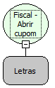

Descrição:

Abre o cupom fiscal na impressora.

Parâmetros:

1. CNPJ_CPF (29 caracteres)

Retorno:

0: Erro de comunicação.

1: OK.

2: Parâmetro inválido na função.

4: O arquivo de inicialização BemaFI32.ini não foi encontrado no diretório de sistema do Windows.

5: Erro ao abrir a porta de comunicação.

27: Status da impressora diferente de 6,0,0 (ACK, ST1 e ST2).

Observações:

1. O cupom fiscal deve estar fechado.

2. Na impressora fiscal YANCO, o parâmetro CNPJ/CPF não existe e não será impresso no Cupom Fiscal, mas a DLL efetua o tratamento e compatibiliza a função.

Nome Real:

ebfBematechFiscalOpenCoupon

Compatibilidade:

Cliente
