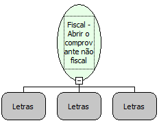

Descrição:

Abre o comprovante não fiscal vinculado.

Parâmetros:

1. Forma de pagamento (16 caracteres)

2. Valor pago na forma de pagamento (14 dígitos com 2 casas decimais)

3. Número do cupom a que se refere o comprovante (6 dígitos.)

Retorno:

0: Erro de comunicação.

1: OK.

2: Parâmetro inválido na função.

4: O arquivo de inicialização não foi encontrado no diretório de sistema do Windows.

5: Erro ao abrir a porta de comunicação.

27: Status da impressora diferente de 6,0,0 (ACK, ST1 e ST2).

Observações:

1. A forma de pagamento utilizada não pode ser dinheiro.

2. A forma de pagamento deve ter sido utilizada no cupom.

3. Só pode ser emitido um comprovante não fiscal por forma de pagamento.

4. Os parâmetros "Valor" e "Numero do Cupom" tornam-se obrigatórios se o comprovante emitido não for referente ao último cupom fiscal emitido.

5. Na impressora fiscal YANCO, os parâmetros utilizados nesta função são opcionais. O Comprovante Não Fiscal Vinculado é aberto independente da forma de pagamento impressa no Cupom Fiscal.

Nome Real:

ebfBematechFiscalOpenVoucherNoFiscalLinked

Compatibilidade:

Cliente
