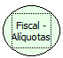

Descrição:

Retorna as alíquotas cadastradas na impressora.

Parâmetros:

Não possui

Retorno:

Alíquotas cadastradas na impressora.

Observação:

As alíquotas retornadas estarão separadas por vírgula. Ex.: 1200, 1700, 0500, 1800

Nome Real:

ebfBematechFiscalReturnPiece

Compatibilidade:

Cliente
