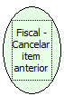

Descrição:

Cancela o último item vendido.

Parâmetros:

Não possui

Retorno:

0: Erro de comunicação.

1: OK.

4: O arquivo de inicialização não foi encontrado no diretório de sistema do Windows.

5: Erro ao abrir a porta de comunicação.

27: Status da impressora diferente de 6,0,0 (ACK, ST1 e ST2).

Observações:

1. O cupom fiscal deve estar aberto

2. Ao menos um ítem deve ter sido vendido

3. Não deve ter sido cancelado nenhum item imediatamente anterior

Nome Real:

ebfBematechFiscalCancelPreviousItem

Compatibilidade:

Cliente
