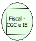

Descrição:

Retorna o CGC e a Inscrição Estadual do cliente/proprietário cadastrado na impressora.

Parâmetros:

Não possui

Retorno:

Lista de retorno(CGC, IE)

Nome Real:

ebfBematechFiscalCGCIE

Compatibilidade:

Cliente
