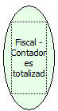

Descrição:

Retorna o número de vezes em que os totalizadores não sujeitos ao ICMS foram usados.

Parâmetros:

Não possui

Retorno:

O número de vezes em que os totalizadores não sujeitos ao ICMS foram usados.

Observações:

1. A impressora fiscal BEMATECH, permite a programação de até 50 totalizadores não fiscais, porém essa função retorna somente os contadores dos 9 primeiros totalizadores cadastrados.

2. O conteúdo da variável retornada será 36 dígitos separados de 4 em 4 por vírgura que representam os 9 primeiros totalizadores. Ex.: "0001,0003,0001,0005,0004,0002,0003,0004,0007"

3. O primeiro valor corresponde ao número de vezes que o totalizador 01 foi usado, o segundo corresponde ao totalizador 02 e assim sucessivamente.

4. A impressora fiscal YANCO não possui contadores dos totalizadores não fiscais. Será retornado zero, nas posições.

Nome Real:

ebfBematechFiscalAccountantTotalizerNoFiscal

Compatibilidade:

Cliente
