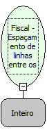

Descrição:

Programa o espaçamento de linhas entre os cupons.

Parâmetros:

1. Espaçamento entre os cupons

Retorno:

0: Erro de comunicação.

1: OK.

2: Parâmetro inválido na função.

4: O arquivo de inicialização BemaFI32.ini não foi encontrado no diretório de sistema do Windows.

5: Erro ao abrir a porta de comunicação.

27: Status da impressora diferente de 6,0,0 (ACK, ST1 e ST2).

30: Função não compatível com a impressora YANCO.

Observações:

1. O parâmetro de entrada tem que ser  entre 0 e 255 indicando o número de linhas. O valor default da impressora é 8 linhas.

2. Na impressora fiscal YANCO, esta programação não existe.

Nome Real:

ebfBematechFiscalLinesAmongCoupons

Compatibilidade:

Cliente
