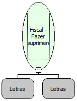

Descrição:

Faz um suprimento na impressora (entrada de dinheiro).

Parâmetros:

1. Valor do suprimento (14 dígitos com 2 casas decimais)

2. Forma de Pagamento(Forma de pagamento (16 caracteres)

Retorno:

0: Erro de comunicação.

1: OK.

2: Parâmetro inválido na função.

4: O arquivo de inicialização não foi encontrado no diretório de sistema do Windows.

5: Erro ao abrir a porta de comunicação.

27: Status da impressora diferente de 6,0,0 (ACK, ST1 e ST2).

Observações:

1. Se a forma de pagamento não dor informada, o suprimento será feito em Dinheiro.

2. Na impressora fiscal YANCO, o Suprimento é impresso como Recebimento e em Dinheiro.

Nome Real:

ebfBematechFiscalSupply

Compatibilidade:

Cliente
