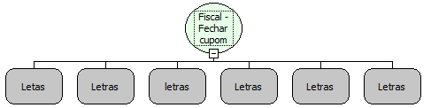

Descrição:

Fecha o cupom fiscal com a impressão da mensagem promocional.

Parâmetros:

1. Forma de Pagamento (16 caracteres)

2. Acrescimo ou Desconto

             A - para acréscimo

             D - para desconto

3. Tipo de Acrescimo ou Desconto

             $ - para desconto por valor

             % - para percentual

4. Valor do Acrescimo ou Desconto (14 dígitos para acréscimo ou desconto por valor e 4 dígitos para acréscimo ou desconto por percentual)

5. Valor Pago (14 dígitos)

6. Mensagem

             (384 caracteres) (8 linhas X 48 colunas) - impressora fiscal MP-20 FI II

             (320 caracteres) (8 linhas X 40 colunas) - impressora fiscal MP-40 FI II

Retorno:

0: Erro de comunicação.

1: OK.

2: Parâmetro inválido na função.

4: O arquivo de inicialização não foi encontrado no diretório de sistema do Windows.

5: Erro ao abrir a porta de comunicação.

27: Status da impressora diferente de 6,0,0 (ACK, ST1 e ST2).

Observações:

1. O cupom deve estar aberto.

2. Pelo menos 1 (um) item deve ter sido vendido e não pode ter sido cancelado.

3. A utilização essa função elimina a obrigatoriedade de uso das funções "Fiscal - Iniciar fechamento de cupom",  "Fiscal - Efetuar forma de pagamento" e "Fiscal - Terminar fechamento do cupom" que estão implementadas internamente na função.

4. Na impressora fiscal YANCO, se a forma de pagamento não estiver cadastrada na impressora, a função retorna erro. A programação das formas de pagamento é feita, somente, por Interveção Técnica.

Nome Real:

ebfBematechFiscalCloseCoupon

Compatibilidade:

Cliente
