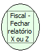

Descrição:

Esta função realiza o fechamento do Relatório X ou do Relatório Z, quando o mesmo estiver aberto e não finalizado.

Parâmetros:

Não possui

Retorno:

0: Erro de comunicação.

1: OK.

4: O arquivo de inicialização BemaFI32.ini não foi encontrado no diretório de sistema do Windows.

5: Erro ao abrir a porta de comunicação.

27: Status da impressora diferente de 6,0,0 (ACK, ST1 e ST2).

Nome Real:

ebfBematechFiscalcloseReportXZ

Compatibilidade:

Cliente
