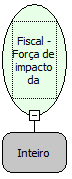

Descrição:

Permite tornar a impressão mais forte nos equipamentos baseados na MP-20 FI II.

Parâmetros:

1. Força de impacto

   1- Impacto fraco(Default)

   2- Impacto médio

   3- Impacto forte

Observações:

1. A seleção de uma força de impacto diferente da default implica na diminuição da vida útil do cabeçote de impressão.

2. Na impressora fiscal YANCO, esta programação não existe.

Retorno:

0. Erro de comunicação.

1. OK.

2. Parâmetro inválido na função.

4. O arquivo de inicialização não foi encontrado no diretório de sistema do Windows.

5. Erro ao abrir a porta de comunicação.

27. Status da impressora diferente de 6,0,0 (ACK, ST1 e ST2).

30: Função não compatível com a impressora YANCO.

Nome Real:

ebfBematechFiscalLinesSpace

Compatibilidade:

Cliente
