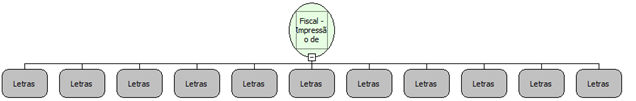

Descrição:

Imprime um carnê de pagamento.

Parâmetros:

1. Titulo para o carnê, impresso centralizado e expandido em cada parcela (20 caracteres)

2. O(s) valor(es) de cada parcela, separadas por ';' (ponto virgula), com duas casas decimais obrigatóriamente.

              (Formatos válidos: "23,23;1.200,00" ou "2323;120000".)

3. A(s) data(s) de vencimento das parcelas separadas por ';'.

              (Formato válidos: "10/10/2003;10112003; ".)

4. Quantidade de Parcelas. Deve ser diferente de zero.

5. Texto livre (200 caracteres.)

6. Nome do cliente (30 caracteres)

7. Número do RG/CPF do cliente. Pode ser nulo ou vazio.

8. COO do Cupom Fiscal (6 caracteres)

9. Quantidade de Vias. (1 ou 2 apenas)

10. Assinatura

              1: Habilita a impressão de uma linha tracejada para a assinatura do cliente.

              0: Não habilita a impressão da linha tracejada para a assinatura do cliente.

Retorno:

0 - Erro de comunicação.

1 - Ok.

1 - Erro de execução.

2 - Erro de parâmetros.

27: Status da impressora diferente de 6,0,0 (ACK, ST1 e ST2).

Observações:

1. Para o parâmetro Parcelas, quando passado um número menor de parcelas na string do que passado no parâmetro quantidade, o valor das parcelas não passadas será iguado ao último valor válido na string. Por exemplo, caso seja passado "20,00;12000;340" em parcelas e 6 em quantidade, o valor de cada parcela será impresso da seguinte forma, respectivamente: R$ 20,00 ... R$ 120,00 ... R$ 3,40 ... R$ 3,40 ... R$ 3,40 ... R$ 3,40. Caso o valor passado em quantidade sema menor do que o número de parcelas encontradas em parcelas, a função retorna erro de parâmetros.

2. Para o parâmetro Datas, quando passado um número menor de datas do que passado no parâmetro quantidade, as datas ausentes serão calculadas e impressas com acréscimo de um mês, a partir da última data válida. Por exemplo, caso seja passado "20/09/1999;31/12/1999" no parâmetro datas e 5 no parâmetro quantidade, serão impressas no ca

Nome Real:

ebfBematechFiscalPrintPaymentBook

Compatibilidade:

Cliente
