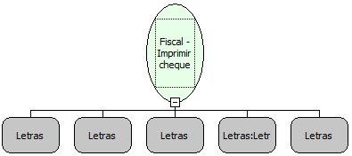

Descrição:

Imprime cheque na impressora MP-40 FI II Bematech e na impressora YANCO 8500.

Parâmetros:

1. Número do banco (3 dígitos)

2. Valor do cheque (14 dígitos)

3. Favorecido (45 caracteres)

4. Cidade (27 caracteres)

5. Data  (Formato: ddmmaa, dd/mm/aa, ddmmaaaa ou dd/mm/aaaa)

6. Comentários (120 caracteres)

Retorno:

0: Erro de comunicação.

1: OK.

2: Parâmetro inválido na função.

4: O arquivo de inicialização não foi encontrado no diretório de sistema do Windows.

5: Erro ao abrir a porta de comunicação.

7: Banco não encontrado no arquivo BemaFI32.ini.

27: Status da impressora diferente de 6,0,0 (ACK, ST1 e ST2).

Observação:

Função usada somente na impressora BEMATECH MP-40 FI II e na impressora YANCO 8500.

Nome Real:

ebfBematechFiscalPrintCheck

Compatibilidade:

Cliente
