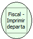

Descrição:

Imprime os departamentos e seus valores acumulados em um relatório gerencial. Será emitida uma leitura X antes.  Essas informações eram impressas na leitura X até a versão 3.0 e foram retiradas por solicitação do fisco.

Parâmetros:

Não possui

Retorno:

0: Erro de comunicação.

1: OK.

2: Parâmetro inválido na função.

4: O arquivo de inicialização BemaFI32.ini não foi encontrado no diretório de sistema do Windows.

5: Erro ao abrir a porta de comunicação.

8: Erro ao criar ou gravar no arquivo STATUS.TXT ou RETORNO.TXT.

27: Status da impressora diferente de 6,0,0 (ACK, ST1 e ST2).

30: Função não compatível com a impressora YANCO.

Observação:

Na impressora fiscal YANCO, este comando não existe.

Nome real:

ebfBematechFiscalPrintDepartments

Compatibilidade:

Cliente
