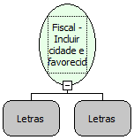

Descrição:

Inclui o nome da cidade e do favorecido no arquivo de configuração da impressora.

Parâmetros:

1. Nome da cidade (27 caracteres)

2. Nome do favorecido (45 caracteres)

Retorno:

1: OK.

1: Erro de execução da função.

2: Parâmetro inválido na função.

27: Status da impressora diferente de 6,0,0 (ACK, ST1 e ST2).

Observações:

1. Após gravar o nome da cidade e do favorecido no arquivo de configuração não é mais necessário passar essas informações como parâmetros para a função "Fiscal - Imprimir cheque", a não ser que seja necessário imprimir uma cidade ou um favorecido diferente aos que estão programados.

2. Função usada somente na impressora BEMATECH MP-40 FI II e impressora YANCO 8500.

Nome Real:

ebfBematechFiscalIncludeFavoredCity

Compatibilidade:

Cliente
