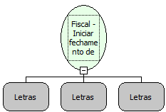

Descrição:

Inicia o fechamento do cupom com o uso das formas de pagamento.

Parâmetros:

1. Acrescimo ou Desconto

                 A - acréscimo

                 D - para desconto.

2. Tipo de Acrescimo ou desconto

                 $ - desconto por valor

                 % -  desconto por percentual

3. Valor de Acrescimo ou Desconto (14 dígitos por valor e 4 dígitos por percentual)

Retorno:

0: Erro de comunicação.

1: OK.

2: Parâmetro inválido na função.

4: O arquivo de inicialização BemaFI32.ini não foi encontrado no diretório de sistema do Windows.

5: Erro ao abrir a porta de comunicação.

27: Status da impressora diferente de 6,0,0 (ACK, ST1 e ST2).

Observações:

1. O cupom deve estar aberto

2. Pelo menos um item deve ter sido vendido

3. O valor do acréscimo ou descontado deve ser menor que o subtotal do cupom.

4. Na impressora fiscal YANCO, caso não seja informado um acréscimo ou desconto, a linha do TOTAL não aparecerá impressa.

Nome Real:

ebfBematechFiscalBeginsClosingCoupon

Compatibilidade:

Cliente
