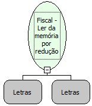

Descrição:

Emite a leitura da memória fiscal da impressora por intervalo de reduções.

Parâmetros:

Redução Inicial (4 dígitos)

Redução Final  (4 dígitos)

Retorno:

0: Erro de comunicação.

1: OK.

2: Parâmetro inválido na função.

4: O arquivo de inicialização não foi encontrado no diretório de sistema do Windows.

5: Erro ao abrir a porta de comunicação.

27: Status da impressora diferente de 6,0,0 (ACK, ST1 e ST2).

Observação:

O cupom fiscal deve estar fechado.

Nome Real:

ebfBematechFiscalReadingFiscalMemoryReduction

Compatibilidade:

Cliente
