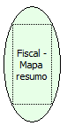

Descrição:

Gera o relatório "Mapa Resumo" referente ao movimento do dia. As informações serão geradas no arquivo RETORNO.TXT no diretório configurado no parâmetro "path" do arquivo ini. O diretório default configurado é o diretório raiz (C:\).

Parâmetros:

Não possui

Retorno:

0: Erro de comunicação.

1: OK.

4: O arquivo de inicialização não foi encontrado no diretório de sistema do Windows.

5: Erro ao abrir a porta de comunicação.

8: Erro ao criar ou gravar no arquivo STATUS.TXT ou RETORNO.TXT.

27: Status da impressora diferente de 6,0,0 (ACK, ST1 e ST2).

Observações:

1. Após a linha "Substituição Tributária" serão gravadas as informações de vendas referente as alíquotas de ICMS. Portanto, o número de linhas irá variar de acordo com o número de alíquotas de ICMS cadastradas na impressora.

2. As informações contidas no mapa resumo serão referentes aos dados da última redução Z, portanto, para gerar o mapa resumo referente ao movimento do dia você deve executar essa função após a redução Z, caso contrário o mapa resumo será gerado com as informações referente ao movimento do dia anterior.

Nome Real:

ebfBematechFiscalMapSummary

Compatibilidade:

Cliente
