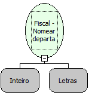

Descrição:

Programa departamento na impressora.

Parâmetros:

1. Índice do departamento

2. Nome do departamento

Retorno:

0: Erro de comunicação.

1: OK.

2: Parâmetro inválido na função.

4: O arquivo de inicialização BemaFI32.ini não foi encontrado no diretório de sistema do Windows.

5: Erro ao abrir a porta de comunicação.

27: Status da impressora diferente de 6,0,0 (ACK, ST1 e ST2).

30: Função não compatível com a impressora YANCO.

Observações:

1. O cupom fiscal deve estar fechado

2. Será executada somente após uma Redução Z

3. Na impressora fiscal YANCO, esta programaçã não existe

Nome Real:

ebfBematechFiscalNameDepartment

Compatibilidade:

Cliente
