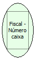

Descrição:

Retorna o número do caixa cadastrado na impressora.

Parâmetros:

Não possui.

Retorno:

Número caixa cadastrado na impressora

Nome Real:

ebfBematechFiscalNumberBox

Compatibilidade:

Cliente
