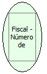

Descrição:

Retorna o número de intervenções técnicas realizadas na impressora.

Parâmetros:

Não possui.

Retorno:

Número de intervenções técnicas realizadas na impressora

Nome Real:

ebfBematechFiscalNumberInterference

Compatibilidade:

Cliente
