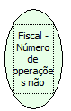

Descrição:

Retorna o número de operações não fiscais executadas na impressora.

Parâmetros:

Não possui

Retorno:

Número de operações não fiscais executadas na impressora

Nome Real:

ebfBematechFiscalNumberOperationsNoFiscal

Compatibilidade:

Cliente
