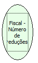

Descrição:

Retorna o número de reduções Z realizadas na impressora.

Parâmetros:

Não possui

Retorno:

Número de reduções Z realizadas na impressora

Nome Real:

ebfBematechFiscalNumberReductions

Compatibilidade:

Cliente
