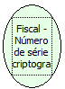

Descrição:

Retorna o número de série da impressora criptografado.

Parâmetros:

Não possui

Retorno

Número de série criptografado

Observação:

Para os modelos MP-25 FI, MP-50 FI, MP-2000 TH FI, MP-2100 TH FI e MP-6000 TH FI, a chave "Impressora" deve estar igual a 1 (Impressora=1) no arquivo de configuração BemaFI32.ini para que o número de série retornado seja de 20 caracteres para a criptografia. Caso esta chave esteja igual a 0 (Impressora=0), serão retornados apenas 15 caracteres para a criptografia

Nome Real:

ebfBematechFiscalEncriptSeriesNumber

Compatibilidade:

Cliente
