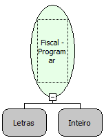

Descrição:

Programa alíquota tributária na Impressora Fiscal.

Parâmetros:

1. Alíquota

2. Vínculo

   0- ICMS

   1- ISS

Retorno:

0: Erro de comunicação.

1: OK.

2: Parâmetro inválido na função.

4: O arquivo de inicialização não foi encontrado no diretório de sistema do Windows.

5: Erro ao abrir a porta de comunicação.

27: Status da impressora diferente de 6,0,0 (ACK, ST1 e ST2).

30: Função não compatível com a impressora YANCO.

Observações:

1. O cupom fiscal deve estar fechado.

2. Na impressora fiscal YANCO, a programação da Alíquota só é realizada por Intervenção Técnica.

3. Nas impressoras fiscais MP-2000 TH FI, MP-6000 TH FI, MP-25 FI e MP-50 FI a programação da alíquota só será permitida somente após uma Redução Z.

Nome Real:

ebfBematechFiscalProgramPercentage

Compatibilidade:

Cliente
