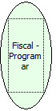

Descrição:

Programa o modo arrendondamento na impressora. Este arredondamento se refere à venda de item com quantidade fracionária.

Parâmetros:

Não possui

Parâmetros:

0: Erro de comunicação.

1: OK.

4: O arquivo de inicialização BemaFI32.ini não foi encontrado no diretório de sistema do Windows.

5: Erro ao abrir a porta de comunicação.

27: Status da impressora diferente de 6,0,0 (ACK, ST1 e ST2).

30: Função não compatível com a impressora YANCO.

Observações:

1. O cupom fiscal deve estar fechado.

2. Será executada somente após uma Redução Z.

3. Na impressora fiscal YANCO, esta programação não existe.

4. Nas impressoras fiscais MP-2000 TH FI, MP-6000 TH FI, MP-25 FI e MP-50 FI está programação não existe. Elas somente operam em modo de truncamento.

Nome Real:

ebfBematechFiscalProgramRound

Compatibilidade:

Cliente
