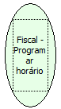

Descrição:

Programa e desprograma o horário de verão. Se a impressora já estiver no horário de verão o mesmo será desprogramado atrasando o relógio em 1 (uma) hora, caso contrário será adiantado 1 (uma) hora.

Parâmetros:

Não possui

Retorno:

0: Erro de comunicação.

1: OK.

4: O arquivo de inicialização não foi encontrado no diretório de sistema do Windows.

5: Erro ao abrir a porta de comunicação.

27: Status da impressora diferente de 6,0,0 (ACK, ST1 e ST2).

30: Função não compatível com a impressora YANCO.

Observação:

A programação do horário de verão será realizada somente após uma Redução Z. Para desprogramar, somente 1 (uma) hora após a Redução Z e não pode ter havido movimento na impressora nesse período.

Nome Real:

ebfBematechFiscalProgramDaylightSaving

Compatibilidade:

Cliente
