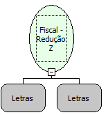

Descrição:

Emite a Redução Z na impressora. Permite ajustar o relógio interno da impressora em até 5 minutos.

Parâmetros:

1. Data atual (Formato: ddmmaa ou dd/mm/aa, dd/mm/aaaa ou dd/mm/aa)

2. Hora a ser alterada (formato hhmmss ou hh:mm:ss)

Retorno:

0: Erro de comunicação.

1: OK.

2: Parâmetro inválido na função.

4: O arquivo de inicialização não foi encontrado no diretório de sistema do Windows.

5: Erro ao abrir a porta de comunicação.

27: Status da impressora diferente de 6,0,0 (ACK, ST1 e ST2).

Nome Real:

ebfBematechFiscalReducaoZ

Compatibilidade:

Cliente
