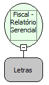

Descrição:

Imprime o relatório gerencial travando e destravando automaticamente o teclado e o mouse. Esta função pode ser utlizada para a impressão do texto da transação TEF. Não é necessário usar nenhuma outra função ou API do Windows para travar o teclado e o mouse.

Parâmetros:

1. Texto a ser impresso no relatório (618 caracteres)

Retorno:

0: Erro de comunicação.

1: OK.

2: Parâmetro inválido na função.

4: O arquivo de inicialização BemaFI32.ini não foi encontrado no diretório de sistema do Windows.

5: Erro ao abrir a porta de comunicação.

27: Status da impressora diferente de 6,0,0 (ACK, ST1 e ST2).

Observações:

1. O cupom fiscal deve estar fechado.

2. Se qualquer função diferente da "Fiscal - Relatório Gerencial TEF" for chamada com o relatorio aberto, efetuará seu fechamento automaticamente.

3. Para fechar o relatório gerencial use a função "Fiscal - Encerrar comprovante fiscal não vinculado".

Nome Real:

ebfBematechFiscalManagerialReportTEF

Compatibilidade:

Cliente
