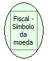

Descrição:

Retorna o símbolo da moeda cadastrado na impressora.

Parâmetros:

Não possui

Retorno:

Símbolo da moeda cadastrada na impressora

Nome Real:

ebfBematechFiscalSymbolCoin

Compatibilidade:

Cliente
