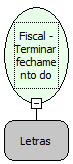

Descrição:

Termina o fechamento do cupom com mensagem promocional.

Parâmetros:

1. Mensagem(384 caracteres) (8 linhas X 48 colunas)

Retorno:

0: Erro de comunicação.

1: OK.

-2: Parâmetro inválido na função.

-4: O arquivo de inicialização BemaFI32.ini não foi encontrado no diretório de sistema do Windows.

-5: Erro ao abrir a porta de comunicação.

-27: Status da impressora diferente de 6,0,0 (ACK, ST1 e ST2).

-36: Forma de pagamento não finalizada.

Observações:

1. A impressora fiscal MP-20 FI II, é 320 caracteres (8 linhas X 40 colunas), para a impressora fiscal MP-40 FI II.

2. A forma de pagamento deve ter sido efetuada.

3. Na impressora fiscal BEMATECH, serão impressas 8 linhas de texto.

4. Na impressora fiscal YANCO, serão impressas 4 linhas de texto. Cada linha com 46 colunas.

Nome Real:

ebfBematechFiscalFinishClosingCoupon

Compatibilidade:

Cliente
