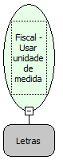

Descrição:

Imprime a unidade de medida após a quantidade do produto na venda de item.

Parâmetros:

Unidade de medida

Retorno:

0: Erro de comunicação.

1: OK.

-2: Parâmetro inválido na função.

-4: O arquivo de inicialização não foi encontrado no diretório de sistema do Windows.

-5: Erro ao abrir a porta de comunicação.

-27: Status da impressora diferente de 6,0,0 (ACK, ST1 e ST2).

-30: Função não compatível com a impressora YANCO.

Observações:

1. Esta função deve ser usada, antes do envio da função Fiscal - Vender item.

2. Esta função tem validade somente para a impressão de um item, voltando ao default que é a impressão de 2 (dois) espaços em branco após a quantidade do item vendido.

3. Na impressora fiscal YANCO, este comando não existe.

4. Nas impressoras fiscais MP-2000 TH FI, MP-6000 TH FI, MP-25 FI e MP-50 FI está programação não existe. Caso você deseje utilizar a unidade de medida, utilize a função Fiscal - Vender item com departamento

Nome real:

ebfBematechFiscalUseUnitMeasure

Compatibilidade:

Cliente
