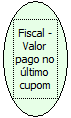

Descrição:

Retorna o valor pago no último cupom.

Parâmetros:

Não possui

Retorno:

Valor pago no último cupom

Observações:

1. Valor pago no último cupom é diferente do valor total do cupom.

2. Na impressora fiscal YANCO, este retorno não existe.

Nome Real:

ebfBematechValueLastCoupon

Compatibilidade:

Cliente
