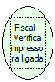

Descrição:

Lê o retorno da impressora referente ao último comando enviado.

Parâmetros:

Não possui.

Retorno:

Ultimo comando enviado.

Nome Real:

ebfBematechFiscalVerifiesLinkedPrinter

Compatibilidade:

Cliente
