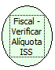

Descrição:

Retorna as alíquotas de vinculação ao ISS.

Parâmetros:

Não possui.

Retorno:

As alíquotas de vinculação ao ISS.

Nome Real:

ebfBematechFiscalVerifyISSPiece

Compatibilidade:

Cliente
