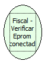

Descrição:

Verifica se a Eprom está conectada.

Parâmetros:

Não possui

Retorno:

1 - Eprom conectada

0 - Eprom desconectada

Nome Real:

ebfBematechFiscalVerifyConnectedEprom

Compatibilidade:

Cliente
