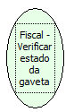

Descrição:

Retorna se a gaveta está fechada ou aberta.

Parâmetros:

Não possui

Parâmetros:

1. Estado da gaveta

1 (sensor em nível 1 - fechada)

0 (sensor em nível 0 - aberta)

Retorno:

0: Erro de comunicação.

1: OK.

-1: Erro de execução da função.

-4: O arquivo de inicialização não foi encontrado no diretório de sistema do Windows.

-5: Erro ao abrir a porta de comunicação.

-8: Erro ao criar ou gravar no arquivo STATUS.TXT ou RETORNO.TXT.

-27: Status da impressora diferente de 6,0,0 (ACK, ST1 e ST2).

Observações:

1. A função retornará estes valores para as impressoras fiscais BEMATECH. Caso esteja utilizando impressora fiscal YANCO, mude a chave "ModoGaveta" (encontrado nas configurações do arquivo de inicialização) para 1 (um), para que os retornos sejam os mesmos citados acima. Não esqueça de mudar a chave "ModeloImp" para YANCO.

2. Em alguns modelos de gaveta, este retorno poderá ser invertido, ou seja, o retorno que corresponde a "gaveta aberta", poderá ser o retorno para "gaveta fechada". Caso isso ocorra, mude a chave "ModoGaveta" (encontrado nas configurações do arquivo de inicialização), para 1 (um) e efetue o teste de retorno, desta função, abrindo e fechando a gaveta.

3. É, extremamente, necessário usar um adaptador de gaveta, caso seja utilizada uma impressora fiscal BEMATECH com gaveta da marca YANCO ou vice-vesa, pois o sinal enviado, pela gaveta, poderá danificar a impressora.

Nome Real:

ebfBematechFiscalVerifyDrawerState

Compatibilidade:

Cliente
