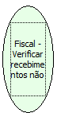

Descrição:

Retorna os recebimentos não fiscais não vinculados programados na impressora.

Parâmetros:

Não possui

Retorno:

Recebimentos não fiscais não vinculados programados na impressora. Essa função retorna as informações para os 50 totalizadores não fiscais não vinculados na seguinte ordem:

Valor indicando quantas vezes cada recebimento foi utilizado:  4 bytes

Valor acumulado para cada recebimento (2 casas decimais)....: 20 bytes

Descrição do recebimento....................................: 19 bytes

Nome Real:

ebfBematechFiscalVerifyReceptionNoFiscal

Compatibilidade:

Cliente
