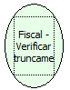

Descrição:

Retorna 1 se a impressora estiver no modo truncamento e 0 se estiver no modo arredondamento.

Parâmetros:

Não possui.

Retorno:

1 - Modo truncamento

0 - Modo arredondamento

Nome Real:

ebfBematechFiscalVerifyTruncation

Compatibilidade:

Cliente
