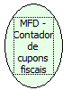

Descrição:

Retorna o número de cupons fiscais emitidos.

Parâmetros:

Não possui

Retorno:

Número de cupons fiscais emitidos

Nome Real:

ebfBematechFiscalMFDAccountantFiscalCoupon

Compatibilidade:

Cliente
