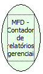

Descrição:

Retorna o número de relatórios gerenciais emitidos.

Parâmetros:

Não possui

Retorno:

Número de relatórios gerenciais

Nome Real:

ebfBematechFiscalMFDManagerialReports

Compatibilidade:

Cliente
