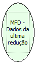

Descrição:

Retorna os dados da impressora no momento da última redução Z.

Parâmetros:

Não possui

Retorno:

Dados da redução

Nome Real:

ebfBematechFiscalMFDDataLastReduction

Compatibilidade:

Cliente
