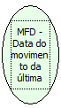

Descrição:

Retorna a data do movimento da última redução Z.

Parâmetros:

Não possui.

Retorno:

Data do movimento.

Observação:

Função disponível para a impressora fiscal térmica MP-2000 TH FI versão 01.00.02 ou 01.01.01.

Nome Real:

ebfBematechFiscalMFDLastReductionMovimentDate

Compatibilidade:

Cliente.
