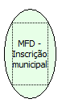

Descrição:

Retorna a incrição municipal do cliente cadatrada na impressora.

Parâmetros:

Não possui

Retorno:

Inscrição municipal

Nome Real:

ebfBematechFiscalMFDMunicipalRegistration

Compatibilidade:

Cliente
