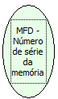

Descrição:

Retorna o número de série da memória de fita detalhe (MFD).

Parâmetros:

Não possui

Retorno:

Número de série

Nome Real:

ebfBematechFiscalMFDMemorySeriesNumber

Compatibilidade:

Cliente
