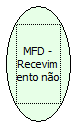

Descrição:

Retorna os recebimentos não fiscais não vinculados programados na impressora.

Parâmetros:

Não possui

Retorno:

Recebimentos não fiscais

Nome Real:

ebfBematechFiscalMFDReceptionNoFiscal

Compatibilidade:

Cliente
