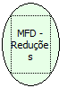

Descrição:

Retorna o número de reduções restantes na impressora.

Parâmetros:

Não possui

Retorno:

Reduções restantes

Nome Real:

ebfBematechFiscalMFDRemainingReductions

Compatibilidade:

Cliente
