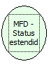

Descrição:

Retorna o status de relatório gerencial ou comprovante não-fiscal aberto.

Parâmetros:

Não possui.

Retorno:

Status

Nome Real:

ebfBematechFiscalMFDExtendedStatus

Compatibilidade:

Cliente
